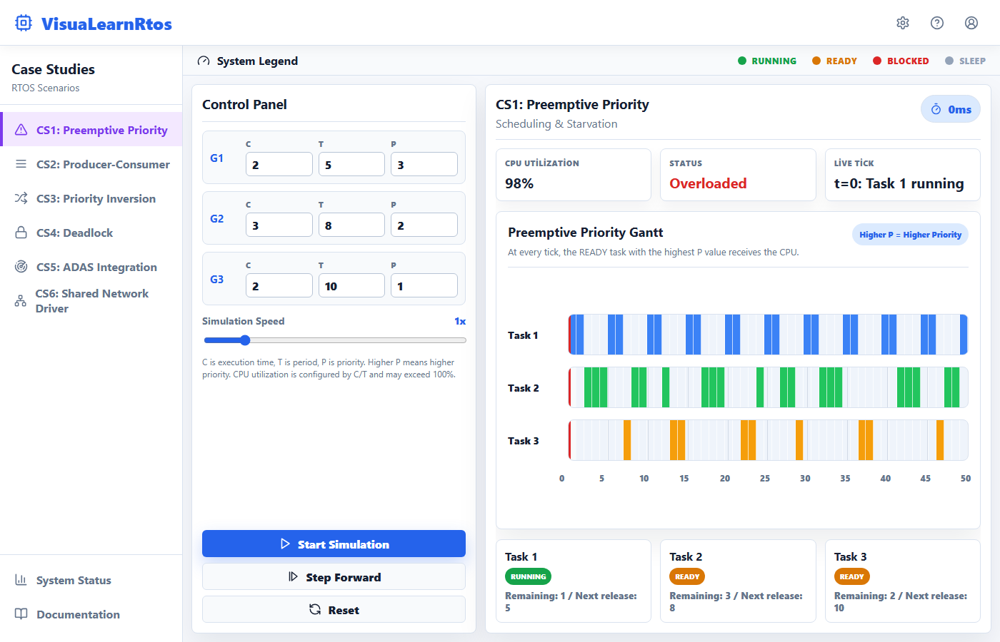
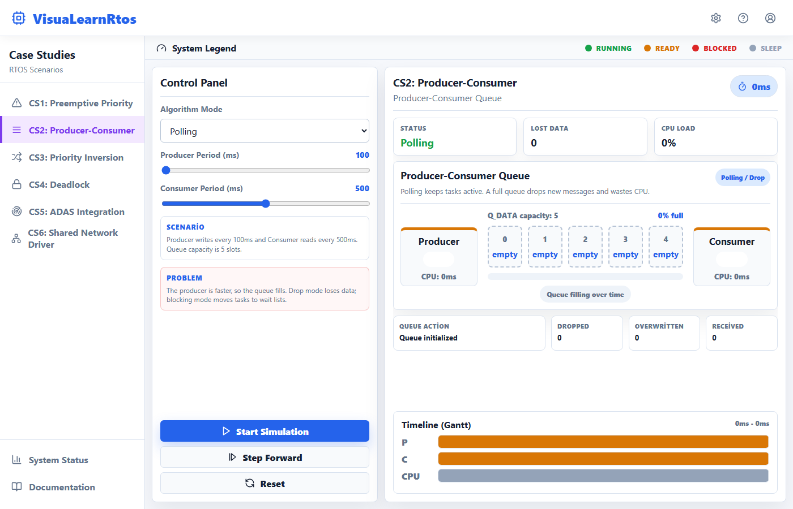
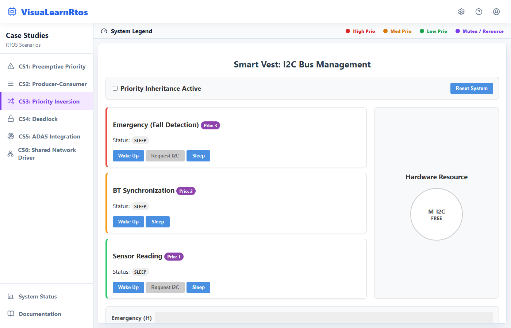
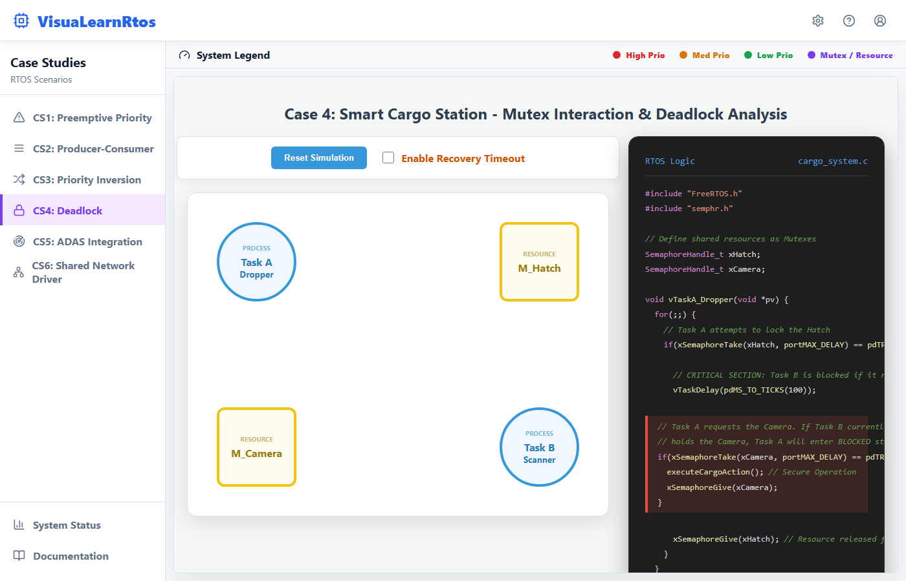
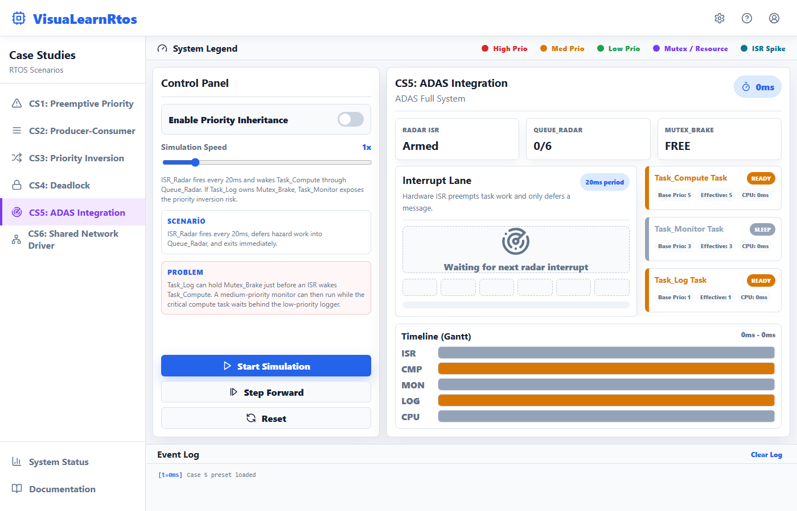
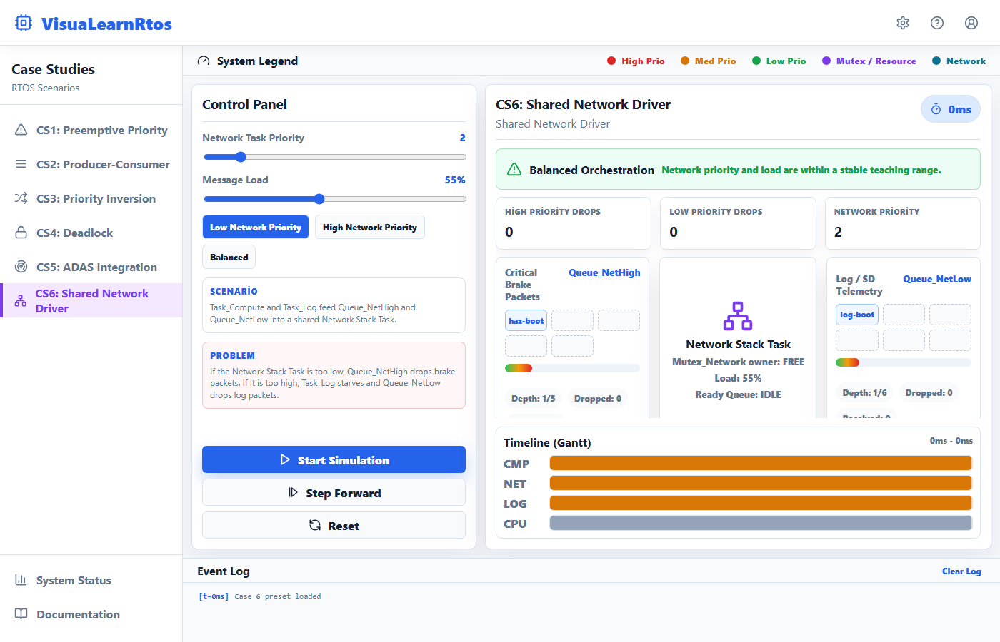

# VisuaLearnRtos

VisuaLearnRtos is an interactive RTOS learning dashboard. It visualizes common real-time operating system problems with task states, mutex ownership, queues, event logs, and Gantt-style timelines.

The project is designed for teaching and experimentation: each case exposes the failure mode first, then lets the user enable or compare a mitigation strategy.

## How to Run

```bash
cd RtosSim
pnpm install
pnpm dev
```

Open the app at:

```text
http://127.0.0.1:5173
```

Use `127.0.0.1` instead of `localhost` if another local service is already bound to IPv6 localhost.

## Scripts

```bash
pnpm dev      # Start the Vite development server
pnpm test     # Run Vitest simulation-rule tests
pnpm build    # Build production assets
pnpm preview  # Preview the production build
```

## Project Structure

```text
RtosSim/
  src/App.jsx                 React UI and case screens
  src/styles.css              Dashboard, lab, Gantt, and canvas styling
  src/sim/core.js             Task, queue, mutex, scheduler, and history primitives
  src/sim/rules.js            Per-case simulation logic
  src/sim/cases.js            Case presets and teaching text
  src/sim/rules.test.js       Simulation behavior tests
  public/cases/priority.html  Standalone CS3 priority inversion simulator
  public/cases/deadlock.html  Standalone CS4 deadlock simulator
  docs/screenshots/           README screenshots
```

## Case Studies

### CS1: Preemptive Priority Scheduling

**Definition:** Preemptive priority scheduling always runs the READY task with the highest effective priority. When a higher-priority task becomes READY, it can immediately preempt a lower-priority task.

**Problem:** A low-priority task can starve if high-priority work keeps arriving. Even if the low-priority task is READY, it may never receive CPU time because the scheduler repeatedly chooses the higher-priority task.

**What the simulation shows:** CPU utilization, live tick ownership, configured task execution/period values, and a Gantt chart showing which task runs at each time slice.

**Mitigation concept:** Aging can gradually increase the effective priority of waiting tasks so a low-priority task eventually gets CPU time.



### CS2: Producer-Consumer Queue

**Definition:** A producer-consumer design uses a queue to decouple a task that generates data from a task that processes data. This is common in RTOS applications where ISR or sensor work must be buffered before processing.

**Problem:** If the producer is faster than the consumer, the queue fills. Depending on the queue policy, new data may be dropped, old data may be overwritten, or tasks may block while waiting for space or data.

**What the simulation shows:** Queue capacity, queue slots, producer/consumer task state, dropped messages, overwritten messages, received messages, and CPU load behavior under different queue modes.

**Mitigation concepts:** Blocking queues reduce busy waiting, while ring buffers preserve the newest data when stale samples are acceptable.



### CS3: Priority Inversion

**Definition:** Priority inversion occurs when a high-priority task waits for a mutex held by a low-priority task, while a medium-priority task preempts the low-priority mutex owner. The high-priority task is indirectly delayed by the medium-priority task.

**Problem:** The scheduler appears to follow priority rules, but the high-priority task cannot run because it is blocked on a resource. Without a protocol, the medium-priority task can keep running and delay the low-priority owner from releasing the mutex.

**What the simulation shows:** A Smart Vest I2C bus example with Emergency, BT Synchronization, and Sensor Reading tasks. The dashboard shows task states, mutex owner, inherited priority, an inversion alert, and a Gantt timeline.

**Mitigation concepts:**

- Priority Inheritance Protocol: temporarily raises the low-priority mutex owner to the waiting high-priority task's priority.
- Priority Ceiling Protocol: raises a task to the resource ceiling as soon as it locks that resource.



### CS4: Deadlock

**Definition:** Deadlock is a state where tasks wait forever because each task holds a resource that another task needs. In mutex systems, this is often represented as a wait-for cycle.

**Problem:** Task A can own one mutex while waiting for another mutex owned by Task B, while Task B waits for Task A's mutex. Neither task can proceed, and the system stops making progress.

**What the simulation shows:** A Smart Cargo Station canvas with Task A, Task B, `M_Hatch`, and `M_Camera`. Green arrows show ownership; red dashed arrows show waiting. The code panel remains visible on the right to connect the visual state to RTOS mutex calls.

**Mitigation concepts:**

- Mutex timeout recovery: a blocked task times out and releases resources so the cycle breaks.
- Resource ordering: all tasks acquire shared resources in the same order, preventing circular wait from forming.



### CS5: ADAS Integration

**Definition:** A realistic embedded system often combines interrupts, queues, task scheduling, and mutexes. In an ADAS-style pipeline, an ISR should do minimal work and defer processing to tasks through a queue.

**Problem:** Even if the ISR is short, downstream task interaction can still create latency. For example, a low-priority logging task may hold a brake-related mutex while a high-priority compute task waits after an ISR event.

**What the simulation shows:** Radar ISR firing, queue depth, compute task wakeup, brake mutex ownership, monitor task interference, and priority inheritance behavior in an integrated system.

**Mitigation concept:** Keep ISR work short, use queues for deferred processing, and use priority inheritance around critical mutexes that can block high-priority control tasks.



### CS6: Shared Network Driver

**Definition:** Multiple tasks may share a network driver or hardware interface through queues and a driver mutex. Priority tuning determines which traffic gets serviced first.

**Problem:** If the network task priority is too low, critical high-priority packets may be dropped because queues fill faster than the driver drains them. If the network task priority is too high, lower-priority logging work can starve.

**What the simulation shows:** Separate high/low network queues, queue pressure, drop counters, network stack priority, shared mutex ownership, and starvation indicators.

**Mitigation concept:** Balance network driver priority and load so critical packets drain reliably without starving telemetry or logging work.



## Development Notes

- The React cases use deterministic simulation steps with `TICK_MS = 10`.
- CS3 and CS4 are served as standalone teaching labs from `public/cases`.
- Simulation history is captured for Gantt timelines.
- Event logs are intentionally compact so important state transitions remain visible.

## Verification

Reproduce every scenario in the PDF lab with:

```bash
cd RtosSim
node src/lab/simular_cenarios.mjs todos
```

Pass a scenario name such as `2A`, `3B`, or `5B` to run it alone. The Portuguese answers to all numbered questions are in [docs/respostas-cenarios.md](RtosSim/docs/respostas-cenarios.md).

The current project includes rule-level tests for scheduling, queues, priority inheritance, priority ceiling, deadlock detection, timeout recovery, resource ordering, ADAS ISR behavior, and network backpressure.

Run:

```bash
cd RtosSim
pnpm test
pnpm build
```
